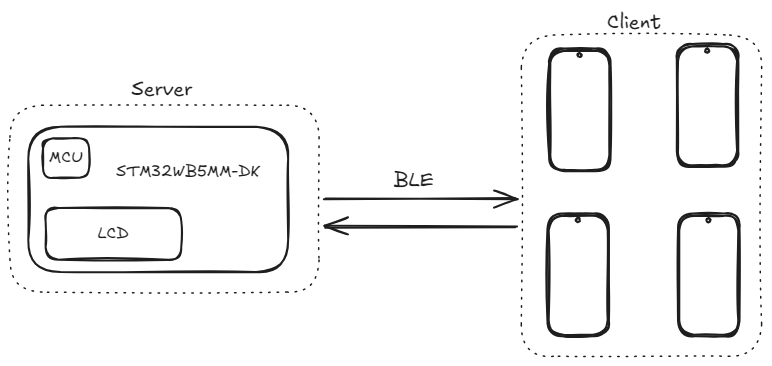
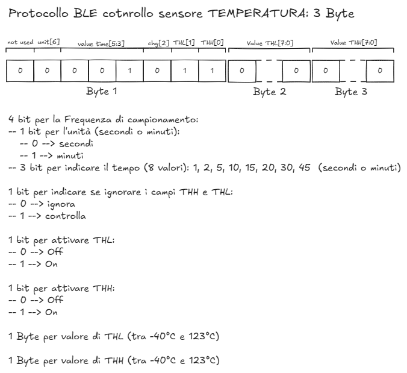

# Progetto Sensors HUB

Il progetto ha come obiettivo quello di imparare a programmare su una piattaforma embedded e con il BLE.

La board: STM32WB5MM-DK presenta diversi moduli, tra cui:
- 128 Mbit di memoria Flash (NOR)
- Accelerometro e Giroscopio
- Sensore di Temperatura
- Time-to-Flight
- Rilevamento dei gesti
- Microfono digitale
- LED RGB e LED infrarosso 
- Micro-controllore: STM32WB5MMGH6U

## Descrizione dello stack BLE:

- INFO -- servizio in cui sono presenti le diverse informazioni della board
- SENSORS -- servizio che gestisce i diversi sensori

|Servizio| Caratteristica | Proprietà     |
|--------|----------------|---------------|
|INFO    | Uptime         | read          |
|        | Date           | read, write   |
|        |                |               |  
|SENSORS | Accelerometro  | read, notify  |
|        | Temperatura    | read, notify  |

Obiettivi: 
- [x] Implementazione del servizio INFO
- [x] Implementazione del servizio SENSORS
- [x] Driver sensore di Temperatura
- [ ] Driver Accelerometro
- [ ] Driver Memoria

## Drivers: Sensore di Temperatura
Il sensore di temperatura, STTS22H, a bordo della STM32WB5MM-DK presenta diverse modalità di misura:
1. `Single Shot Mode`: permette di risparmiare la carica della batteria effettuando una misurazione su richiesta per poi porsi in una modalità _LOW Power_.  
1. `Low ODR Mode`: modalità che effettua misurazioni a un `Output Data Rate` (`ODR`) pari a 1 Hz. 
1. `Freerun Mode`: modalità con cui si possono scegliere a che frequenza campionare, ovvero: 25 Hz, 50 Hz, 100 Hz e 200 Hz.

La comunicazione è effettuata tramite la periferica `I2C`.
Nel caso in cui si volesse ricevere dei `ALERT` in caso di superamento (o abbassamento) della temperatura rispetto alle soglie, è necessario implementare la callback: `HAL_GPIO_EXTI_Callback` per il PIN `PE1`

### Controllo del sensore di Temperatura tramite BLE
